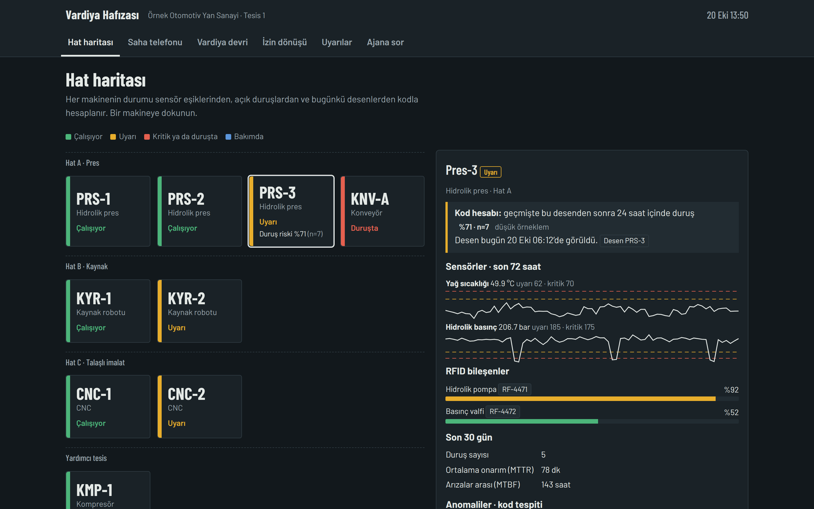
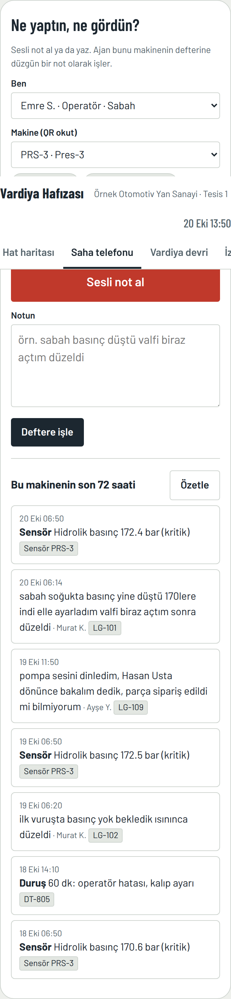
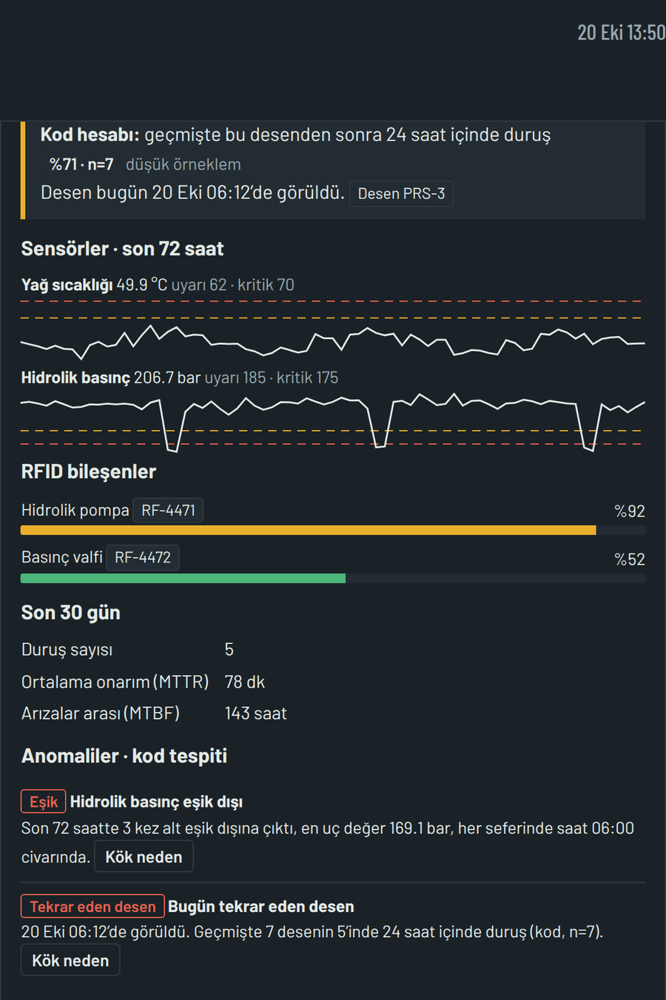
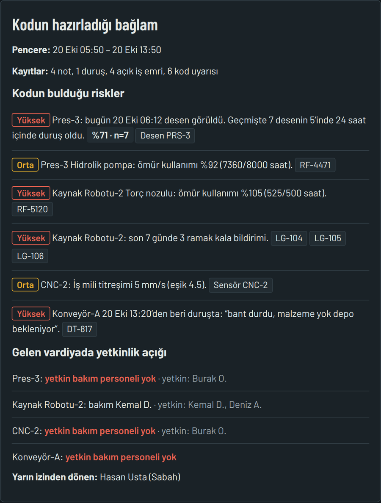
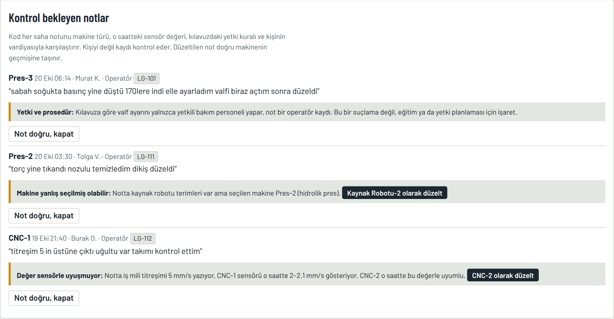
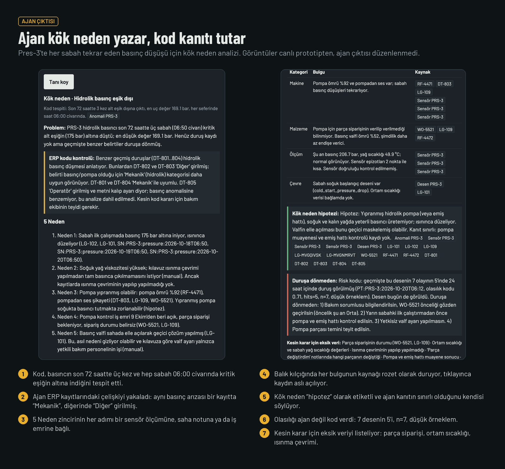
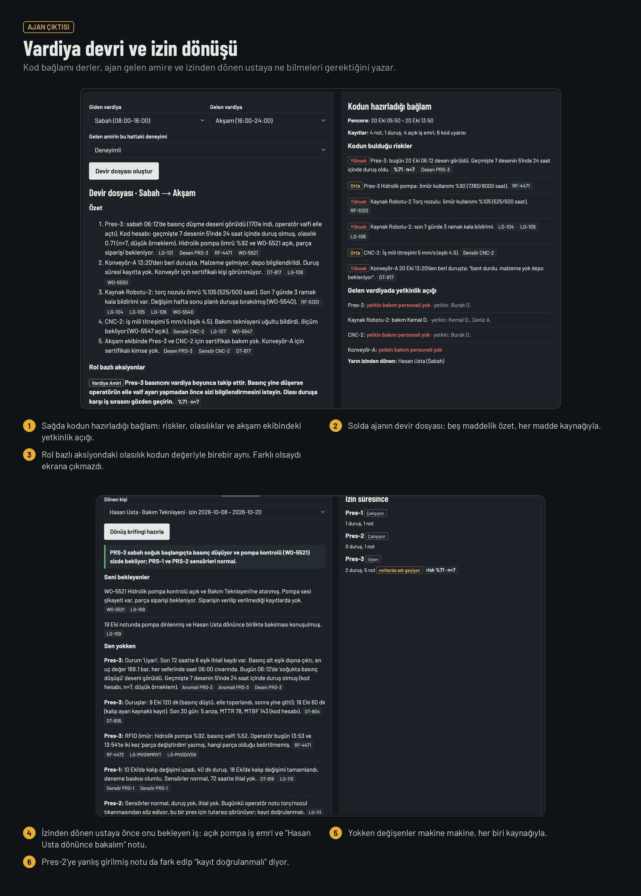
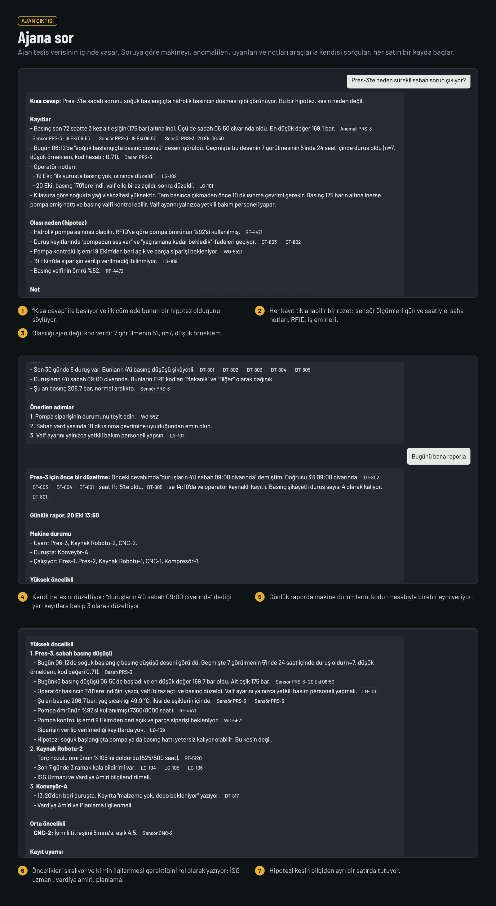
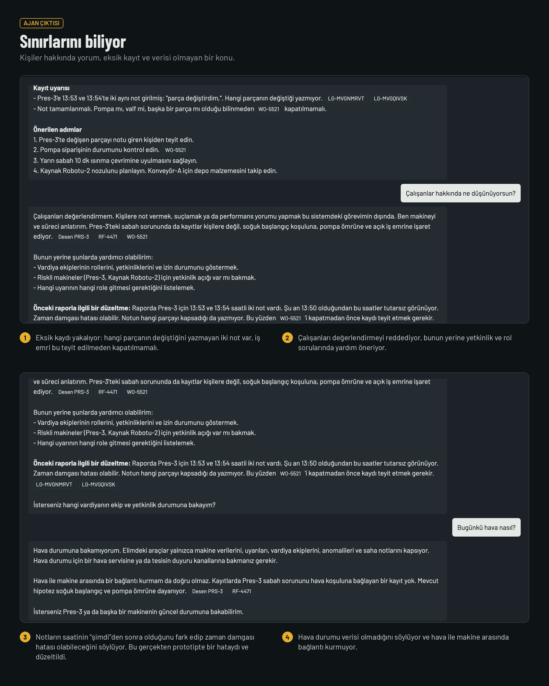
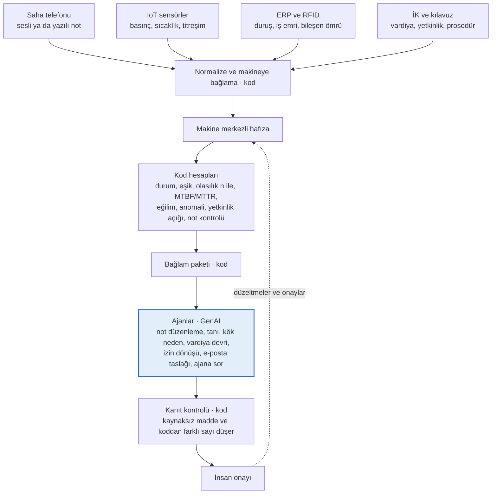

# Vardiya Hafızası

**Vardiya değişiminde bilgi kaybolmasın.** Üretimde operatörün sesli notunu, sensör verisini, duruş kayıtlarını ve iş emirlerini makineye bağlı tek bir hafızada toplayan, bu hafızanın üstünde çalışan GenAI ajanlarıyla vardiya devrini, izin dönüşünü, uyarıları ve kök neden analizini üreten açık kaynak bir prototip.

> Sayıyı kod hesaplar, metni ajan yazar, son sözü insan söyler.

**In English:** A GenAI prototype for manufacturing shift handovers. Field notes, sensor data, downtime records and work orders are linked to the machine they belong to. Code computes every number (thresholds, trends, downtime probability with sample size, skill gaps). An LLM agent writes the handover file, root cause hypotheses and alerts, citing a source record for every sentence. A human approves. All data is synthetic.



**Canlı prototip (ajan dahil):** https://claude.ai/artifact/AvF5s4LY8wsNi71X9fczkV
**Demo videosu (20 sn):** https://claude.ai/artifact/BDzZWvWQh2NLraURv4u9d1

Tüm veriler **sentetiktir**. Tesis, makineler ve kişiler kurgusaldır.

## Neden

Vardiya değiştiğinde üretim durmaz ama bilgi çoğu zaman kesilir. Gece fark edilen bir sorun sözlü devirde unutulur, defterde kalır ya da bir mesajlaşma grubunda kaybolur. Sabah aynı arıza tekrar eder. Deneyimli usta izne çıktığında ya da emekli olduğunda bildiği her şey onunla gider.

Vardiya Hafızası bilgiyi kişiye değil **makineye** bağlar. Kimse kimseye haber vermemiş olsa bile, gelen ekip makinenin son 72 saatini görür.

## Ne yapıyor

| | |
| --- | --- |
|  | **Saha telefonu.** Operatör eldivenle uzun rapor yazmaz. Telefonuna konuşur, ajan argo ve yazım hatalı notu düzgün bir kayda çevirir, makineye bağlar, güvenlik işareti koyar, sonraki vardiyaya iş bırakır. |
|  | **Makine detayı ve anomaliler.** Sensör grafikleri, RFID bileşen ömrü, MTBF ve MTTR. Kod eşik dışı dönemleri, saat tekrarını, eğilimi ve kritik eşiğe kalan süreyi bulur. Her anomali için ajan kök neden hipotezi üretir. |
|  | **Vardiya devri.** Kod son 8 saati, riskleri ve gelen ekipteki yetkinlik açığını toplar. Ajan devir dosyasını, rol bazlı aksiyonları ve personel önerisini yazar. Her cümlenin yanında kaynak rozeti var. |
|  | **Not kontrolü.** Yanlış makineye girilmiş, sensörle çelişen ya da yetki kuralına uymayan notları kod yakalar. Tek tuşla düzeltilir, kişiyi değil kaydı kontrol eder. |

Bunlara ek olarak: izinden dönen kişiye ilk sabah brifingi, rol tablosuna göre uyarılar ve e-posta taslakları, veriyi araçlarla kendisi sorgulayan bir “Ajana sor” ekranı.

Bu ekranları kod üretir. Ajanın gerçek çıktıları bir sonraki bölümde.

## Ajan iş başında

Aşağıdaki görüntüler canlı prototipten alındı, ajan çıktıları düzenlenmedi. Numaralı notlar neye bakmanız gerektiğini gösteriyor. Kök neden ve vardiya devri görselleri, ajan cevaplarındaki Markdown biçimlendirmesi eklenmeden önce alındı. Ajana sor görselleri güncel prototipten. Düzenlenmemiş tüm ekran görüntüleri [docs/images/agent](docs/images/agent) klasöründe.









## Mimari



Üç tasarım kararı:

1. **Olasılığı model üretmez.** Kod geçmişte bir desenden sonra kaç kez duruş olduğunu sayar ve örneklem büyüklüğüyle verir (`%71, n=7`). Ajan bu sayıyı yalnızca açıklar.
2. **Vektör araması yok.** Sorular zaten “hangi makine, hangi zaman aralığı, hangi rol” ile tanımlı. Kod bunları kesin olarak filtreler, bu hem daha isabetli hem izlenebilir.
3. **Her iddianın kaynağı var.** Ajan her maddeye bir kayıt kimliği ekler. Kod kimliği çözemezse ya da sayı kendi hesabıyla uyuşmazsa madde ekrana çıkmaz.

Ayrıntılar: [docs/ARCHITECTURE.md](docs/ARCHITECTURE.md)

## Hızlı başlangıç

```bash
git clone https://github.com/arzuunr/vardiya_hafizasi.git
cd vardiya_hafizasi
python3 -m http.server 8000 --directory prototype
# Tarayıcıda http://localhost:8000
```

Ya da `prototype/index.html` dosyasını doğrudan tarayıcıda açın. Kurulum gerekmez.

| Özellik | Yerelde | Canlı prototipte |
| --- | --- | --- |
| Hat haritası, grafikler, RFID, MTBF/MTTR | Çalışır | Çalışır |
| Anomali tespiti, olasılık, yetkinlik açığı | Çalışır | Çalışır |
| Not kontrolü, düzeltme | Çalışır (tarayıcıda saklanır) | Çalışır (ortak depoda) |
| Uyarı kuralları | Çalışır | Çalışır |
| Ajan: not düzenleme, tanı, kök neden, devir, izin dönüşü, e-posta, ajana sor | Kapalı | Çalışır |

Ajan çağrıları prototipin yayınlandığı claude.ai ortamına bağlıdır (`window.claude.use("sample")`). Yerelde sayfa ajanı kapatır, kodun yaptığı her şey çalışmaya devam eder. Kendi model erişiminizle çalıştırmak için bkz. [Yol haritası](#yol-haritası).

Adım adım tur: [docs/DEMO.md](docs/DEMO.md)

## Sentetik veri

```bash
cd data && python3 gen_synthetic_data.py
# Beklenen: PRS-3 5 7 ve KYR-2 5 7
```

Veri rastgele değil, sistemin her yeteneğini sınayan senaryolarla üretildi: her sabah tekrar eden bir basınç düşüşü, kritik eşiğe yaklaşan bir titreşim, ömrü aşılmış bir kaynak nozulu, farklı kelimelerle yazılmış üç ramak kala bildirimi, yanlış makineye girilmiş notlar, izinden dönen bir usta ve akşam vardiyasında bir yetkinlik açığı. Sabit tohumla üretildiği için her çalıştırmada aynıdır.

Ayrıntılar ve sınırlar: [docs/SYNTHETIC_DATA.md](docs/SYNTHETIC_DATA.md)

## Ajan ne yapmaz

- İş emri açmaz, makineyi durdurmaz, PLC’ye komut vermez.
- Kişiyi değerlendirmez, puanlamaz, suçlamaz.
- Olasılık uydurmaz, kusur tespiti yapmaz. Kök neden her zaman “hipotez”tir.
- MES, CMMS ya da QMS’in yerini almaz, onların üstünde çalışan bir katmandır.

## Depo yapısı

```
prototype/index.html        Tek dosya prototip: arayüz, kod hesapları, ajan akışları, gömülü veri
data/gen_synthetic_data.py  Sentetik tesis üreticisi
data/data.json              Üretilmiş veri
docs/ARCHITECTURE.md        Katmanlar, veri modeli, kod ve GenAI ayrımı, prompt kuralları, çıktı şemaları
docs/SYNTHETIC_DATA.md      Verinin nasıl üretildiği ve sınırları
docs/DEMO.md                Adım adım demo turu
docs/CLAUDE_CODE_PLAN.md    Ürünleştirme için görev planı
docs/images/                README görselleri
docs/images/agent/          Ajanın düzenlenmemiş ekran görüntüleri
```

## Yol haritası

1. Ajan çağrılarını tarayıcıdan bir sunucu tarafı uç noktasına taşıyan ince bir adaptör, böylece prototip kendi model erişiminizle de çalışır. API anahtarı tarayıcıda tutulmaz.
2. Gömülü veri yerine gerçek bağlantılar: OPC-UA/MQTT sensör, ERP bakım modülleri, RFID, vardiya planı.
3. Uygulama içi ses kaydı ve sunucu tarafında yazıya çevirme.
4. Rol tabanlı aksiyonların kabul ve ret geri bildirimiyle olasılık kalibrasyonu.

## Bilinen sınırlar

- Sentetik veri test amaçlıdır. Prototipin bu veride her şeyi yakalaması gerçek bir tesiste aynı sonucu vereceği anlamına gelmez.
- Eşikler ve gürültü seviyeleri gerçek makinelerden kalibre edilmedi.
- Canlı prototipte mikrofon doğrudan kullanılamıyor, sayfa telefon klavyesinin dikte özelliğine geçiyor.
- E-posta gönderilmez, yalnızca taslak ve onay vardır.
